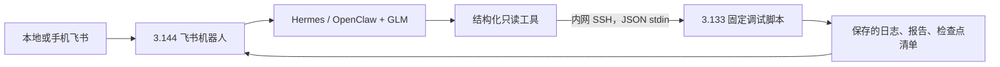

# Cosmos 3 相机数据与视觉扩增离线准备

历史离线准备阶段（2026-10-19）：当时只修改本地代码、执行 CPU 契约与媒体检查。训练保持暂停；没有连接
192.168.3.133 / 192.168.3.144，没有下载 Cosmos 权重、调用推理服务或部署飞书工具。
当时新相机接口尚待 GPU 验证；后续实际验证进度见下节，不能把历史暂停状态当成当前状态。

## 2026-10-20：RGB 闭环及移动技能验证

本轮按用户授权在 `192.168.0.103` 的隔离训练副本运行仿真。Cosmos 权重仍未部署、未调用推理服务。
当前识别器是本项目用仿真图像训练的小型灰度 U-Net，不是 Cosmos 模型。

已连接的路径：远距观察全长 → 学习分割 → 原始分辨率亚像素边缘/圆柱拟合 →
带时间戳的视觉中心/轴向 → 任务路点与阶段 → 机器人动作/试验机闭合。
运行相机只开启 `rgb`，转换为腕部 mono8；没有渲染深度、语义输出或标签查询。
运行控制包括观察姿态、阶段推进、actor 输入和夹紧触发均受 `vision.blind.blinded_control` 约束；
访问钢筋/料台真值、奖励逻辑或钢筋身份过滤接触力会直接报错。
复位、训练标签和独立评分仍可使用真值。手指/四爪改用原始净接触载荷。

| 实验 | 结果 | 范围 |
|---|---|---|
| `vision_servo_106042_caps_v2` | 4/4，最终实际位置误差 1.02–1.60 mm | 固定底盘、纯视觉伺服；3 mm 对准/交接判据未放宽 |
| `vision_policy_118042_v2_attempt3` | 3/4，一组退出时超力 | 全部操作动作为神经策略；失败已进入 DAgger 重放，不能称稳定策略 |
| `vision_policy_118042_v4_regression_attempt2` | 4/4 | 失败种子回归；这些状态曾参与 DAgger，不是独立测试 |
| `vision_policy_122042_v4_holdout` | 4/4，实际误差 1.25–1.55 mm | 未参与适配的新种子；神经操作动作，无教师接管 |
| `vision_policy_123042_v4_outage_video_v2` | 1/1，实际误差 1.38 mm | 新种子，抓持后 10 帧黑图；暂停 26 个控制步后恢复，录像约 79 s |
| `mobile_tray_probe_v3` | 1/1，最大相对位移 2.10 mm | 从已在托槽上的钢筋开始，验证物理行驶/转向；不是全链验收 |
| `mobile_place_119042_v1` | 1/1，93.4 s | 未固定底盘，视觉抓取、旋转、放槽、松爪、撤离；真值独立确认在槽 |
| `mobile_navigation_packets_v12_polarity` | 1/1，101.8 s，槽内轴向位移 2.85 mm | 托槽初始化的独立课程；实际绕过控制柜并精确停靠，无腕部换视角；不是整链 |
| `mobile_dock_regrasp_119042_v2_traypose` | 0/1，最终误差 3.02 mm | 完成夹持交接但超出独立 3 mm 评分门槛，明确不算成功 |
| `mobile_dock_regrasp_119042_v3_margin_attempt2` | 1/1，110.2 s，最终误差 1.90 mm | 托槽/到站复位的独立课程；真实再抓取、抬高、插入、夹紧、释放和撤离 |
| `mobile_full_119042_v6_margin_video` | **1/1，301.4 s，最终误差 2.12 mm** | **从料台取料开始的实际连续回合**；放槽、导航、停靠、再抓取、插入夹紧、松爪撤离；无阶段复位 |
| `mobile_full_125042_v7_recording` | **1/1，306.6 s，最终误差 2.47 mm** | **新复位种子的实际连续回合**；控制器不变，修正独立录像相机；导航和夹紧均有可查看全景 |

报告与权重保存在 `artifacts/visual_control_20261019/`。表中种子不是大规模泛化证据。
`loading_visual_v1` 维度仍为 71，actor 使用前 56 维；钢筋量与控制阶段已来自独立视觉估计。
视觉适配是旧 PPO 先验上的 BC/DAgger，不能将它表述为新完成的视觉 PPO 长训。
`visual_check --checkpoint ... --label-replay ...` 只给学生实际访问的状态标记教师动作，
实际执行始终为学生动作；教师没有偷偷接管失败阶段。

单目量测假设当前 24 mm × 600 mm 钢筋、标定内外参和已测支承平面。
初始定位要求三帧全长与两端可见；近距端部遮挡后，沿轴位移不可观，使用视觉初始化的抓取/FK 先验，
不是将钢筋附着到夹爪。图像过期 200 ms 后停止任务推进并保持机器人；不会回退至仿真真值。
远距视野中的失败曾由梯度搜索窗口越过图像边界造成，现只保留真实画面内的样本，仍拒绝真正截断的端部。
后续托槽回放发现分割可能漏掉端部十几像素、内部肋纹梯度更强，端面现取外侧完整梯度簇；
真实失败包（图像、同帧 K/TF 与实际概率图）残差从约 9 px 降至 0.5–0.7 px，2.5 px 拒绝阈值不变。
近零坐标的浮点凸包拟合改用绝对增量 Jacobian。更新后原独立观察集 40/40 帧有效，P95 误差 1.00 mm；
这是同一个留出回合中的抽样帧，不是 40 个独立回合。

相机中断曾暴露保持错误：每帧用当前关节位置覆盖目标会失去抗重力位置误差，导致负载下沉。
现只在暂停进入时锁存带负载偏置的目标并去掉速度项。上述黑图试验已实际验证保持、恢复和交接。
夹紧后使用实测四爪总法向载荷至少 40 N 才进入释放；原始手指载荷卸载连续 3 步后才允许撤离。
视觉估计器在设备承载时切换支撑先验，避免将开爪期间的腕部误差当成钢筋轴向运动；没有修改钢筋物理状态。

移动资产通过 `mobile_assets --parked <完整机构资产> --output <新目录>` 单独生成，保留原固定底盘基线。
`assets_mobile_v2` 使用源项目真实托槽形状，74 个有效接触碰撞体，独立托槽载荷刚体；
没有钢筋固定关节、运动学保持或运行中钢筋位姿写入。浮动 articulation 的根显式设为底盘。
`mobile_mission_check --until tray|dock|clamp` 分阶段验收；全链控制器目前是视觉伺服加里程计导航原型，
不是完整流程 RL 或 Nav2 避障验收。移动时以底盘里程计统一相机/FK 坐标，
托槽全长图像持续重新测量轴向位置；新鲜图像、托槽支撑、收臂、松爪与命令租约任一失效即停止车轮命令。
取料后约 4 mm 的槽内轴向滑移已由独立评分记录，必须在导航前/到站后重新观察，不能沿用抓取先验。
全链表项来自一次实际连续运行，没有托槽/到站初始化、外部视觉提示或中途状态恢复；
分段课程不计入整链成功率。当前两组种子各一个完整回合，尚非大样本、场景变化或真实硬件的稳定性结论。
移动租约比较采用整数纳秒，避免浮点秒换算把新图像误判为“未来帧”；真实过期/未来时间仍拒绝。
低对比度导致持续失效时，先停车，再在有界的空手腕部视角间重新观察，不降低视觉/力判据。
每次长回合绑定启动时的源码快照与 SHA-256，避免后续改动污染正在执行的验收。
旧的 x=4.5 m 绕行线与完整模型的控制柜碰撞；现从真实 CAD 碰撞体生成底盘高度障碍边界，
绕行线改为 x=3.37 m，并检查直线段及原地转向的车身轮廓。该检查不包含动态障碍，不能替代 Nav2。
连续两秒有行驶命令却无里程计进展时判定受阻并停车；相机互锁停车会重置该计时，避免误判。
到站后的动作目标单独变换到当前底盘坐标，避免沿用固定工位的插入位置。
控制柜附近的背景会使端面明暗反转。托槽跟踪现用上一帧视觉量测和当前手眼标定预测两端投影，
仅在各端的 8 px 窗口内搜索双极性图像梯度，再联合已知直径/长度/支承平面拟合；
两端各至少两条实际图像边缘、2.5 px 残差上限和 10 mm 支承运动界限缺一不可。
预测不能替代图像证据；到站后只把之前的视觉量测作为搜索提示，仍须三帧图像重新确认再抓取。
`--start-on-tray --start-at-dock --until clamp` 单独检验最后一段；
`--survey-from-packet` 仅从之前保存的 mono/K/TF 图像重新推理搜索提示，不读取记录中的评分真值。
这类复位课程在报告中明确标为非端到端；整链命令不使用这些初始化参数。
移动控制的夹紧触发要求视觉误差不超过 0.8 mm，为估计误差留余量；独立实际误差评分仍为 3 mm。
再抓取前只要两端可见就继续测量轴向位置；端部遮挡后的 FK 先验仍明确标记轴向不可观。
首轮完整运行源码快照 SHA-256 为 `45f9fb4f73cb2ad288cfda67f8a9099e0fa3d257e3e9220de460091c866bf173`；
修正录像器相机并通过新种子复测的源码 SHA 为 `c360d63359bbc8bc44b4b8ec14e76388daac08d07da3e7aea94902e1be7998cb`。
两版仅 `mobile_mission_check.py` 的录像及复位课程入口有变化，控制模块一致。
首轮录像全景固定在取料台，腕部画面与评分完整；交付录像使用 v7，已抽查取料、导航和设备交接画面。
两轮整链导航日志的采样最大槽内相对偏移分别为 9.33 mm、10.96 mm；视觉持续重测并在到站后重新确认，
不能用装槽完成时的位置代替后续钢筋位置。
完整回合只使用灰度识别器、视觉伺服、任务状态机和底盘里程计，没有完整流程神经策略或 Cosmos 推理。
运行频率为物理 120 Hz、控制 30 Hz、相机/渲染 10 Hz，物理步长与力/对准评分未改变。

## 0.103 上的模型核对与视觉闭环路线

2026-10-19 后续已按用户授权在 `192.168.0.103` 完成状态策略课程和 1500 次 PPO 更新，
两组独立种子各 100/100 回合成功。RTX 全景视频已实际录制；这不等于腕部单目、深度、
语义标签和控制时序的联合采集已经通过验证。Cosmos 服务尚未部署或调用，本次核对没有启动训练。

核对源项目 `/home/arnold/Develop/ROS_ws/hongshi_mm_ws/src/AuboAMR300_ROS2` 当前提交
`a29ee253cf822ac971a026c5a96a7e3cb70be5ff`：训练 manifest 中 14 个源文件的 SHA-256 全部一致。
主模型是 `seer_description/urdf/rebar_test_machine_lab.usda`，完整场景为
`seer_description/urdf/warehouse_finger_rebar_lab_demo.usda`。
差异来自训练覆盖层：`assets.py` 禁用了 `UpperCarriage`、`LowerCarriage`，
用四个有真实接触和滑动关节的夹垫代替原来的横梁/夹持头/爪片。
原项目文档明确其设备尺寸来自照片估计，移动机构及钢筋保持用于流程演示，并非夹持力仿真。
恢复外观时应把完整机构与接触夹垫合并成物理一致的机构，禁止把演示的钢筋保持逻辑用于 RL 验收。
旧 200/200 只覆盖现有简化工位，不覆盖升级模型或视觉策略。

建议按以下顺序实施：

1. **完整测试机物理化。** 恢复上下横梁、夹持头、爪片和正确可达空间，建立相应碰撞、
   关节、夹持面、行程与力参数；先重新验证真实抓取/交接和复位，保留当前已验收权重作为基线。
2. **腕部相机与几何定位。** 使用 `/camera/image_raw`、`/camera/camera_info` 和 FK/TF，
   核对视野、相机内外参、手眼变换和时间同步。现有 MV-CH100-60UM 是黑白单目；
   OBB 的中心和角度不等于三维位姿。取料先利用已知台面平面，夹具定位结合已知尺寸、
   标记或多视角。仿真深度只作监督标签，不作为实机可用输入。
3. **采集与 Cosmos 扩增。** 同步保存原始腕部图像、关节状态、后续动作、钢筋/夹具真值、
   成功与失败结果。用 Nano/Super Transfer 的 edge/depth/seg 控制改变光照、材质、背景、锈蚀等外观。
   先核对输出的钢筋边界、轴线、夹持点和时序，再决定是否复用标签；生成视频不替代 PhysX 接触或奖励。
4. **视觉估计驱动动作策略。** 复用项目 `object_detection` 的旋转框代码，补充钢筋端点/分割、
   夹具定位和置信度，输出统一的带时间戳位姿估计。当前 Ubuntu 项目目录未找到 README 所列
   `rebar*.pt` 权重，需先迁移或重新训练。所有 actor 输入以及路点/阶段计算中依赖钢筋真值的部分
   均需改为视觉估计；仿真真值只用于标注、奖励、教师/critic 和验收。再以估计误差、遮挡、
   帧延迟和目标移动做课程训练，测试集独立划分，不以现有状态策略的结果代替视觉验收。
5. **Cosmos 在线理解和后续视觉动作模型。** 先让 Cosmos 识别目标关系、选择目标钢筋、
   检查夹具状态和解释失败；精密定位与快速动作闭环由感知几何和小型动作策略负责。
   然后评估 Cosmos3-Edge-Policy-DROID 作为本任务视觉动作微调起点，完成具身、坐标系、
   动作语义与频率适配；它的现成 DROID 8D 输出不能直接作为本项目 7D 关节速度/夹爪指令。

模型及算力安排以实测为准：Edge 4B 可作为 24GB 节点上在线理解的小样候选；
Edge 不支持当前 v2v Transfer 工作流，离线视觉扩增仍使用 Nano/Super。
官方 Transfer 指南建议 RTX PRO 6000 Blackwell 96GB、H100 80GB 等大显存 GPU；
明确提示 DGX Spark 虽可满足部分内存门槛，但速度慢，不推荐用于该工作流。
因此不预设 24GB 卡能同时承载 Isaac 和完整 Transfer，先跑短片显存/延迟测试，再安排独立生成资源。
Cosmos 环境与现有 Isaac Python 环境隔离。

模型接口注意：官方 DROID 策略卡要求 RGB 输入，单目灰度可按输入预处理复制为三通道，
但这没有恢复颜色信息，需要在同样的灰度分布上适配并单独验证。

### 扩展目标：移动取料直到试验机夹紧

原有状态策略验收是固定底盘的机械臂技能。原始观测为 71 维，`route_heads_v1` actor
只读取前 56 维：关节位置/速度、TCP/腕部轴向、钢筋仿真位置/轴向/速度、相对路点、
双指/四爪接触力、夹具关节、逻辑阶段和进度。后 15 维动作历史/目标不被该 actor 使用。
输出为 6 个归一化关节速度和 1 个对称夹爪指令，30 Hz；不输出底盘速度。
测试覆盖固定工位附近的复位扰动，不等于任意世界坐标取料，也没有视觉闭环或拉伸试验。

端到端任务应采用统一任务管理器，连接以下独立技能：

| 阶段 | 可复用基础 | 必须补齐的反馈与验收 |
|---|---|---|
| 目标选择和定位 | `object_detection` 旋转框、腕部相机 | 钢筋端点/轴线、可信三维坐标、时间戳、遮挡处理 |
| 导航至取料区 | `isaac_navigation.launch.py` / `isaac_nav2.yaml`；实车 SEER 独立接口 | 地图到机器人 TF、新鲜定位、避障、带载轮廓和到站确认 |
| 精确停靠后抓取 | 现有真实接触抓取技能 | 用相对机器人坐标、视觉精定位；无固定关节附着的抓持确认 |
| 携料移动 | `rebar_tester_mission` 流程结构 | 优先车载托槽承托；装槽/再取料分别验证。持筋行驶需另验加减速、负载碰撞体和防滑落 |
| 测试台停靠与插入 | 现有插入/上料技能、完整测试机 | 停靠误差课程、夹具坐标估计、力限制、插入失败后退与重定位 |
| 夹紧确认与交接 | 四夹爪接触判据、松爪/撤离和稳定保持判据 | 设备允许上料、夹爪位置/力和保持反馈；不以“已发送闭合”认定成功 |

现有 `seer_description/README_REBAR_COMPACT_EXPERIMENT.md` 保存过完整脚本演示，
但原 `rebar_tester_control.py` 的钢筋附着/运动学保持不能迁入真实接触 RL 验收。
`aubo_seer_mission` 是导航加机械臂服务的基础框架，不是此任务已完成的调度器；
接口状态码、失败/取消和新鲜反馈必须逐项核对，不直接把所有终态当作到站成功。
当前新训练工作区不运行这些实车接口。

当前 actor 的双指/四爪“钢筋过滤接触力”来自仿真，并不能预设实机有同样的传感器通道。
接实机前还要核对夹爪状态、试验机 PLC/通信接口、压力/力/到位反馈，用实际可获得的信号
重做观测和交接判据。Cosmos 对画面的“看起来夹住了”不能替代这些确认。

Cosmos 的接入位置：离线使用 Nano/Super Transfer 扩充外观；在线先评估 Edge 的
目标选择、场景理解和失败解释。几何定位、导航避障、接触力反馈和设备夹紧确认仍由对应模块执行。
只有固定工位视觉技能和移动技能分别通过后，才做跨工位连续回合，统计每阶段失败原因与整链成功率。

新增 `vision.geometry` 是不读取仿真真值或深度的单目几何接口：由去畸变端点、K、手眼/TF
和已知钢筋中心线支承平面估计三维中心/轴向，拒绝过期、低置信度、近乎平行射线及长度不符的结果。
端点必须由独立检测器给出；仿真语义和真值只用于检查。它尚未连接 actor，不能把此接口测试称为视觉策略验收。

### 完整机构与相机实测中的修正

升级资产通过 `python -m rebar_training.assets --output-dir <新目录> --fixture-model full_v2`
生成；运行时仅为该进程设置 `REBAR_TRAINING_ASSETS=<新目录>`。默认 `pads_v1` 和既有验收权重不被替换。
`full_machine.py` 把原模型横梁、夹持头、爪片接到真实刚体/滑动关节：2 个 Z 轴和 4 个 Y 轴。
横梁中央碰撞体保留导柱间隙；参数仍是估计代理，未宣称真实设备校准。

恢复下横梁后发现原代理工作高度与固定底座重叠约 15 mm；单看“交接成功”会漏掉这项机构错误。
上、下工作高度最终改到模型行程内的 1.88 / 1.136 m，夹持中心为 1.508 m，
钢筋端部与爪片主体各留约 7 mm 净空。完整机构的对准/保持位置判据收紧到 3 mm（原 8 mm），
升降轴偏离指令超过 2 mm 时验收失败；原接触、过力、掉落和松爪稳定判据保留。
这些改变需要重新适配策略，不能沿用旧成功率。

实际 GPU 相机检查发现两项离线 doubles 无法发现的问题：

- PhysX 中的腕部相机 FrameView 一直读取导入 USD 的静止位姿。现在由实际 `mono_camera_link`
  刚体位姿与源 USD 的固定安装变换更新光学相机，再读取当前图像/标定矩阵。
- RTX 在 `colorize=False` 下仍返回打包 RGBA 的 int32 语义数据及颜色元组映射。
  现在将它转换成显式整数类别和查找表；扩增输出的语义颜色按类别名称固定，不随帧内 ID 变化。

修正后的失败回合也作为诊断样本保存，不能当成功示教。独立投影检查保存于
`artifacts/full_machine_vision_20261019/camera_fk_geometry_review/report.json`：抽样可见中心线点
在腕部图像上 150/150、全景上 530/544 落入钢筋标签 2 像素邻域；这只是仿真投影一致性，
不等于实机手眼标定或传感器延迟验收。旧静止腕部采集已写入拒绝审查，扩增规划器拒绝使用。

腕部近距离图像可见钢筋主体，但两端会超出画面。全流程取料前必须增加可观察钢筋全长的观察姿态
或额外视角；几何接口拒绝把被截断的端点当成钢筋中心。现有精密抓取图像不能独自证明已能搜索任意钢筋。

严格版本在种子 81042 的 32 个专家回合全部通过后，以旧 PPO 策略为起点、冻结原归一化，
用这些新示教适配 300 个监督训练 epoch。独立种子 83042 的状态策略评估 32/32 成功；
种子 84042 的相机采集回合也成功（974 步，末端钢筋位置误差约 0.77 mm）。
两次策略评估均无专家接管、无过力/掉落或超时。它是 **PPO 基线经新机构示教适配后的状态策略**，
不是新做了 1500 次 PPO，也不是视觉策略。现有结果只覆盖固定工位配置，不覆盖导航和实机。
新权重 `artifacts/full_machine_vision_20261019/warm_bc_precision.pt` 与旧 `model_1499.pt` 分开保存。

成功回合保存 325 组双相机图像/深度/语义及状态。新增抽样检查：腕部 140/140、
全景 509/526 个可见中心线点落在标签 2 像素邻域。检查报告与源数据、权重已同步本机。
实际素材已生成 6 个 Nano Transfer 离线任务，并为覆盖阶段 6 至 10 的交接片段编码控制视频、
生成 `/v1/infer` 请求文件；`sent=false`，没有下载 Cosmos 权重或调用推理服务。
扩增规划保留最后一段均匀采样图像，避免截掉夹紧/松爪事件，终止的非网格图像仍保留在原数据中。
总报告：`artifacts/full_machine_vision_20261019/integration_report.json`；
固定 Ubuntu 环境的项目测试为 122 项通过。所有本轮训练/验证进程已结束，未启动新的长训。

官方依据：[Cosmos 模型与工作流](https://github.com/NVIDIA/cosmos/blob/main/docs/reference/models.md)、
[Transfer 控制、资源与接口](https://github.com/NVIDIA/cosmos/blob/main/cookbooks/cosmos3/nim/transfer.md)、
[Edge DROID 策略卡](https://huggingface.co/nvidia/Cosmos3-Edge-Policy-DROID)。
核对记录：`artifacts/migration_0103_20261019/model_source_audit.json`。

## 采集接口

安装独立 CPU 环境的可选依赖：

```bash
uv sync --project rebar_training --extra offline --extra vision
uv run --project rebar_training --extra offline --extra vision python -m pytest -q rebar_training/tests
uv run --project rebar_training --extra vision python -m rebar_training.vision check-config \
  --config rebar_training/config/vision_capture.json
```

默认训练配置不创建相机。`gpu_check` 需要同时传入 `--camera-config`、`--camera-dataset`
和 `--enable_cameras` 才启用采集，且不允许与在线 DAgger 更新混用。配置限制最多 4 个仿真环境，
默认只存 env 0，每 3 个控制步采一次（30 Hz 控制 / 10 Hz 图像），终止帧无论是否在采样网格上均保存。

| 视角 | 默认配置 | 用途 |
|---|---|---|
| wrist | 现有 `Robot/mono_camera_link/camera_optical_frame/ros2_camera`，1024×615 mono8 | 候选视觉策略输入；继承源 USD 的 12 mm 镜头与安装位姿 |
| overview | 新建独立固定相机，640×384 RGB | 排查轨迹与遮挡；`policy_observable=false` |

相机 `CameraCfg` / `ProxyArray.torch` 接口依据固定标签 `v3.0.0-beta2.patch1` 源码准备。
所有位姿与控制数据在 `_get_dones()` 内、对应环境自动复位之前读取；相机数据在同一物理步取样，
帧号未推进会直接报错。这个同步方案仍需要 GPU 检查，CPU doubles 不能证明 RTX 图像没有延迟。

**以下命令留到换机并恢复验证之后执行；本轮没有执行：**

```bash
# 新 GPU 环境先安装固定版本 Sim/Lab；不要把 CPU 环境的 Torch 装进 Lab 环境。
uv pip install --python "$ISAACLAB_ROOT/.venv/bin/python" 'Pillow>=10' 'jsonschema>=4.23'
uv pip install --python "$ISAACLAB_ROOT/.venv/bin/python" --no-deps -e "$REBAR_REPO_ROOT/rebar_training"

bash rebar_training/scripts/run_isaac_python.sh -m rebar_training.gpu_check \
  --task loading --expert --num_envs 1 --episodes 4 --seed 42 --headless --enable_cameras \
  --camera-config rebar_training/config/vision_capture.json \
  --camera-dataset rebar_training/artifacts/camera_loading_NEW \
  --report rebar_training/artifacts/camera_loading_NEW_report.json
```

先检查两路画面、腕部视野、钢筋与夹具的标签、K/外参、移动时帧同步、成功/失败/超时前最后一帧，
再扩大采集。腕部相机在部分姿态下看不到钢筋，不能用全景相机图像冒充腕部输入。
实际 MV-CH100-60UM 是黑白单目相机；本接口的深度和分割全部是仿真监督标签，不能当作实机传感器输出。
针孔零畸变和 USD 外参也不代表真实镜头标定结果。

## `rebar_camera_v1` 数据格式

```text
dataset.json                         来源、任务、观测契约、时间/单位、相机配置、fixture/runtime_validated
episodes/<uuid>/episode.json         env ID、seed、complete/interrupted、真实物理终止结果
episodes/<uuid>/frames.jsonl          每行一个采样时刻，含所有相机和动作历史
episodes/<uuid>/wrist/000000.png      mono8 图像；overview 为 rgb8
episodes/<uuid>/wrist/000000_depth_m.npy
episodes/<uuid>/wrist/000000_depth_valid.npy
episodes/<uuid>/wrist/000000_semantic_ids.npy
```

帧 JSON Schema 随包保存于 `src/rebar_training/vision/camera_frame.schema.json`。

- `t_start_ns, t_end_ns, action_applied`：动作在 **(t_start,t_end]** 内施加，图像和状态在 **t_end** 读取。
  这是 post-action 数据，不把上一动作错标成“当前图像之后要执行的动作”。
- `action_history`：保存自上一张图像以来的所有控制步，避免 10 Hz 图像丢掉 30 Hz 动作；
  最后一个动作必须与 `action_applied` 一致，时间必须连续。时间为本次仿真采集的整数纳秒计数，非 UTC。
- `state`：TCP、钢筋中心/轴线/速度/姿态，六个手臂关节（rad、rad/s），两指（m、m/s），
  关节目标、双指/四垫接触力（N）、任务阶段和路径子阶段。
- 每路相机记录实际图像尺寸、编码、帧号、K、`T_env_optical` 和 SHA-256；
  外参把光学坐标（右/下/前）变换到当前 env 的 Z-up 坐标。四元数统一 XYZW。
- 深度为光学 Z 方向的米数；Inf/NaN/非正深度记为 0，并另存有效掩码。
  语义 ID 必须结合该帧 `semantic_mapping` 使用，不固定假定某个数字代表钢筋。
- 每个 env 单独开新回合。采集中止时未完成回合标成 `interrupted`，不推断成功。
  数据目录不可覆盖；`validate` 检查格式、时序、动作连续性、文件校验和图像/标签尺寸。

## 完全离线的接口演练

以下 CPU 样例不是物理轨迹，`fixture=true`，不会被默认加入扩增任务：

```bash
uv run --project rebar_training --extra vision python -m rebar_training.vision demo \
  --output rebar_training/artifacts/camera_contract_demo_NEW
uv run --project rebar_training --extra vision python -m rebar_training.vision validate \
  --dataset rebar_training/artifacts/camera_contract_demo_NEW

uv run --project rebar_training --extra vision python -m rebar_training.vision plan \
  --dataset rebar_training/artifacts/camera_contract_demo_NEW \
  --output rebar_training/artifacts/cosmos_plan_demo_NEW --camera wrist --control edge \
  --prompts rebar_training/config/cosmos_appearance.json --frames 5 --allow-fixture
```

真实采集时去掉 `--allow-fixture`，默认每段 121 帧。只选完整成功回合；中断回合、缺失相机、
非均匀采样和不够长的片段不混入有效控制视频。非网格终止帧保留在源数据，但不会偷偷重采样到视频中。

```bash
# 从 jobs.json 选择一个 job_id；媒体编码只需要本地 ffmpeg，不启动模型。
uv run --project rebar_training --extra vision python -m rebar_training.vision prepare-media \
  --dataset /实际数据目录 --plan /扩增计划目录/jobs.json \
  --job-id ACTUAL_JOB_ID --output rebar_training/artifacts/prepared_NEW
uv run --project rebar_training --extra vision python -m rebar_training.vision nim-request \
  --prepared rebar_training/artifacts/prepared_NEW \
  --output rebar_training/artifacts/prepared_NEW/nim_request.json
```

`prepare-media` 做等比缩放与补边，同时记录像素变换和变换后的 K；不修改原图和原始米制标签。
深度/分割控制视频只是可视化，原始 float32 深度和 int32 标签另存。
`nim-request` 输出官方 Cosmos 3 **NIM `POST /v1/infer`** 的 JSON 请求，包含内嵌 MP4，
不会发 HTTP 请求。它不是任意 Cosmos 服务通用的 OpenAI 请求格式。

| control | 请求准备 |
|---|---|
| edge / blur | 原始视频放入 `input_reference`，由 NIM 提取控制 |
| depth / seg | 仿真标签生成控制视频，放入 `transfer.<control>.video` |

当前只准备 Nano/Super Transfer，拒绝 Edge。新机需按实际 NIM 镜像重新核对支持矩阵、分辨率、
帧数、媒体限制与显存余量；本机的请求导出通过不等于服务已接受请求。
NVIDIA 当前说明 Transfer 宜使用大显存高吞吐独显，DGX Spark 虽可能满足内存下限但速度慢，
不推荐承担这类生成；Spark 很适合先承担机器人网关和调试协调。

所有扩增产物默认 `labels_reusable=false`。生成后须检查钢筋/夹爪/四垫几何、相机、时间及灰度一致性，
再决定是否保留或重新标注。`schemas/augmentation_review.example.json` 是待填写审查记录，
不是自动判别器；当前没有自动继承标签的入口。生成视频也不证明接触力、抓取成功或动作标签有效。

## Hermes + OpenClaw / 飞书远程调试方案



方案可行的条件是：Spark 在线并能接收飞书事件；4090 主机在线且 Spark 可通过 SSH 到达；
Hermes/OpenClaw 实际注册了工具，所用 GLM 后端支持该工具调用。仅能聊天不等于已经拥有调试工具。
离开同一网络后，本地通过飞书与 Spark 通信，4090 主机不需要为此暴露公网端口。
若 4090 关机，只能读取已复制的历史报告，不能声称获得实时 GPU 状态。

本次提供：

- `config/feishu_debug_tools.json`：框架无关的 tool JSON schema 模板，**不是可直接安装的 OpenClaw/Hermes 插件**。
- `scripts/spark_debug_bridge.py`：可复制到 Spark 的桥接程序，默认只输出 SSH 调用计划；
  显式 `--execute-readonly` 或管理员配置 `execute_readonly: true` 后才连接，且要求专用密钥；
  JSON 走 stdin，不拼接模型生成的 shell 命令。
- `scripts/remote_debug_stdio.py`：4090 上固定入口，系统 Python 即可运行，无 Isaac/CUDA 导入。
- 四个操作：`status`、`list_artifacts`、`tail_log`、`inspect_manifest`；限定训练产物目录、限制大小，
  拒绝路径逃逸与启动训练。`status` 说明的是已保存记录，不伪装成实时仿真健康检查。

本地演练（不会 SSH）：

```bash
printf '%s\n' '{"request_id":"check-1","operation":"status"}' | \
  python3 rebar_training/scripts/spark_debug_bridge.py
printf '%s\n' '{"request_id":"check-2","operation":"status"}' | \
  python3 rebar_training/scripts/remote_debug_stdio.py
```

后续真正接入时，在现有 bot 的工具注册层包装桥接脚本，并由 bot 网关验证允许的飞书用户/会话，
使用专用 SSH 密钥和已核对的主机指纹；可将密钥配置为只能调用固定接收脚本。
工具执行结果回到原聊天。消息去重、请求 ID、快速回执、后台查询和超时由网关处理，避免重复执行。
本模块不保存飞书 App Secret、GLM key 或 SSH 私钥，也不会自行发送飞书消息。

现已提供两个原生工具插件及完整的 [3.144 部署步骤](REMOTE_DEBUG_DEPLOY.md)，
位于 `deploy/hermes-rebar/`、`deploy/openclaw-rebar/`。它们只在本地演练，尚未安装至远端。

未来若需要远程改代码、跑诊断或恢复训练，应另加对应的任务执行与补丁审核入口；
当前接口始终返回 `training_paused=true`，自然语言指令不能解除这个服务端限制。

## 官方参考

- [固定 Lab Camera API](https://github.com/isaac-sim/IsaacLab/blob/v3.0.0-beta2.patch1/source/isaaclab/isaaclab/sensors/camera/camera.py)
- [Cosmos 3 NIM Transfer](https://github.com/NVIDIA/cosmos/blob/main/cookbooks/cosmos3/nim/transfer.md)
- [Hermes 插件](https://hermes-agent.nousresearch.com/docs/developer-guide/plugins)
- [OpenClaw 工具插件](https://docs.openclaw.ai/plugins/building-plugins)
