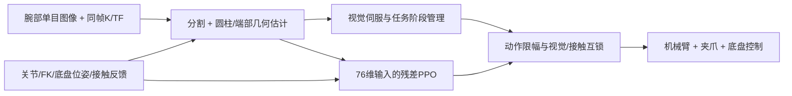

# 当前钢筋算法的运行条件、位置泛化边界与 Cosmos 接入说明

日期：2026-10-24。依据已完成验收的冻结源码、原生报告和 NVIDIA 当日官方资料。

## 1. 当前系统是什么

当前系统是“小型分割网络 + 单目几何估计 + 视觉伺服 + 有界残差 PPO + 固定任务阶段/夹爪管理 + 已测路线的底盘里程计控制”。PPO负责机械臂动作的局部修正，导航、观察、阶段切换和夹爪时序仍由控制程序负责。

钢筋图像先经过本地灰度 U-Net 分割，再结合相机内参、手眼变换、已知钢筋尺寸和支承平面估计中心、轴线及运动。残差策略读取76维视觉估计/机器人反馈，输出6维有界机械臂动作修正；当前修正系数为0.08，这是归一化动作增量系数，不是0.08米或0.08rad。靠近最终插入目标时，修正幅度随误差收小，让视觉伺服负责最后对准。

连续任务为：观察源钢筋 → 抓取 → 抬起/转移 → 放入车载托槽 → 松爪撤离 → 再观察 → 行驶/停靠 → 再抓取 → 抬高 → 插入试验机 → 四爪承载 → 松爪/撤离。

当前报告明确记录 `cosmos_inference=false`、`neural_full_mission=false`、`nav2=false`。本次通过的不是 Cosmos 策略，也不是任意场景的端到端神经导航。

## 2. 所需条件

| 项目 | 当前要求与依据 |
|---|---|
| 机械结构 | 与已验收的机械臂、夹爪、车载托槽、试验机四爪、碰撞模型和运动学一致。更换结构后不能沿用旧验收结论。 |
| 钢筋 | 几何估计默认直径24mm、长度600mm。其他尺寸必须更新几何先验并复测。 |
| 图像 | 腕部黑白单目输入，当前配置1024×615；运行相机启用rgb，再转mono8。不能只用OBB中心/角度代替三维定位。 |
| 标定/时序 | 相机K、相机至机器人/场景的TF、TCP/FK、时间戳须一致。当前视觉有效期200ms，过期不借用钢筋真值补齐。 |
| 初次定位 | 在合格观察位看见钢筋全长及两端，获得3帧稳定全长定位；当前中心位置帧间范围门槛4mm。 |
| 已知几何 | 源钢筋支承高度约0.522m，托槽参考高度约0.715m，均属于当前模型坐标；不能直接当成其他设备通用参数。 |
| 工位定位 | 试验机、料台、托槽、目标轴线、观察位和障碍几何已测定。当前试验机目标的世界坐标XY仍使用约[6,4]m。 |
| 底盘反馈 | 当前仿真由底盘根位姿等反馈建立移动坐标系；真机需要同坐标语义的定位/里程计接口，不能把仿真反馈当成已完成真机定位验证。 |
| 路径 | 已依据CAD障碍检查绕行路线；未实现并验收动态障碍通用导航。 |
| 接触反馈 | 需要手指、四爪、托槽支撑等载荷反馈，用于抓持、运输、释放和撤离判定。仿真接触反馈不等于真机已装好并标定相应传感器。 |
| 运行环境 | 本次为RTX5090 Laptop上的隔离Isaac运行副本；资产manifest记录Isaac Sim 6.0.1、Isaac Lab v3.0.0-beta2.patch1。复现应使用保存的运行环境/资产/配置指纹，不能仅凭版本号认定等效。 |

当前控制约30Hz、相机约10Hz；学习器读取的是视觉估计与机器人反馈，不直接把原始图像端到端映射成全部动作。钢筋真值用于复位、离线标签及独立验收，运行时控制隔离钢筋真值。

抓持后局部端部遮挡时，会利用“视觉初始化的抓取关系 + FK + 后续有效图像”传播估计；这不是钢筋被物理固定到夹爪，也不说明任意遮挡下都能继续。

## 3. 当前证据证明了什么

正式整链64/64成功、0失败，8个完整原生组，Mac与103官方复算一致，零证据错误，Wilson95下界0.9433759402。开发11/11、抓取技能8/8、到站技能8/8和独立演示1/1分别记录，不拼入正式64。

正式64实际误差约0.924–1.437mm；独立评分要求不超过3mm、轴向误差不超过3°，真实四爪各达到载荷门槛，松爪卸载、至少60mm撤离、钢筋速度和无臂接触等同时满足。运行中的视觉夹紧门控为0.8mm，这是估计量的控制门槛，不代表真实误差恒小于0.8mm。

冻结控制源码SHA：`8a24e31302639bb5a666b06d5a962b9033e011df3dad9e342dd40c0eaf28cb58`。

策略及optimizer文件SHA：`393b47f8385a9163e3c9f88b53375923327aa3c80239a3af105e700cf1f93a82`；466 updates / 170 actor updates / 36602 policy steps保持。评估期间没有重训或optimizer重置。

证据入口：

- [正式full独立门槛](../artifacts/mobile_curriculum_20261020/source_return_v2_frozen_acceptance_20261022/full_gate.independently_verified.json)
- [演示独立复核](../artifacts/mobile_curriculum_20261020/source_return_v2_frozen_acceptance_20261022/demo_independently_verified_20261024.json)
- [最终11130文件SHA清单](../artifacts/mobile_curriculum_20261020/source_return_v2_frozen_acceptance_20261022/final_delivery_manifest.both_hosts_verified.json)

以上属于特定场景和扰动分布下的仿真证据，没有证明真实硬件或任意布局的成功率。

## 4. 改变初始姿态和位置，能否自动完成

**在已测条件附近的小变化，有自动修正和恢复能力；大幅换位、换姿态或换设备，目前不能保证自动完成。**

正式64使用 `expanded` 分布，在标称初态附近抽样：

| 参数 | 声明的扰动范围 |
|---|---|
| 源料台及其支承钢筋XY | 每轴±60mm；料台与支承钢筋一起移动 |
| 源料台/钢筋偏航 | ±0.10rad，约±5.73° |
| 机械臂初始关节 | 各关节±0.035rad，约±2.01°；叠加于既定初态，含当前固定腕部偏置 |
| 底盘初始XY | 每轴±20mm |
| 底盘初始偏航 | ±0.02rad，约±1.15° |
| 图像外观 | 增益约0.9–1.1、偏置±4灰度级、噪声标准差1灰度级 |

这些是抽样范围，不是范围内所有组合均已穷举通过，也不是允许任意位置启动的规格书。代码另有challenge分布，不代表本次64已验证challenge。

| 改变方式 | 当前判断 | 需要补充 |
|---|---|---|
| 同一设备，初态轻微偏移且仍能进入观察位 | 已有相近条件下的成功证据，可以先做同策略冻结复测 | 新初态独立回合；保留失败，不能只挑成功 |
| 底盘平移几十厘米/几米或转向很大 | 不保证；可能无法看到源钢筋或进入现有路线 | 初始定位、到源观察位的规划、底盘/机械臂联合可达与碰撞检查 |
| 机械臂换成完全不同的折叠姿态 | 不保证；局部伺服/有限观察搜索不是任意初态全局运动规划器 | 无碰路径回到预观察位，再执行原技能；无法覆盖时再评估策略适配 |
| 把试验机搬到新位置或旋转 | 不能自动发现新夹具位置并把所有目标自动改好 | 重新定位夹具坐标、更新目标轴线/停靠位/观察位和障碍路线，复测完整链 |
| 改料台高度、钢筋尺寸、相机安装位 | 不能直接沿用当前单目尺度与平面先验 | 重标定K/手眼/TCP或平面/钢筋几何，检查检测器及抓取可达性 |
| 更换机械臂、夹爪或底盘型号 | 不属于已验收系统 | 运动学、关节/动作接口、夹持力与接触、控制频率和数据分布适配 |

建议先保持现有393b权重，增加“新初态 → 全局定位/预观察位 → 原视觉技能”的前处理与参数化工位变换。只有冻结复测显示现有策略覆盖不足时，才另行讨论新数据/适配；并非移动设备就必须重训。修改规划或控制后应建立新的独立验收批次，不能把旧64直接当成新布局通过。

## 5. Cosmos 当前状态及合适接入点

本项目已有离线准备模块：`src/rebar_training/vision/augment.py`，CLI为 `python -m rebar_training.vision` 的 `validate / plan / prepare-media / nim-request`。它能检查数据、准备控制视频与请求JSON；`nim-request`明确返回 `sent:false`。**没有实际部署模型、发送推理请求或用生成数据替换本次验收。**

截至本说明日期，NVIDIA当前模型家族为Cosmos 3，分Reasoner理解/推理和Generator生成/动作等路径。Edge为4B、Nano为16B、Super为64B；具体后端、量化及工作负载决定显存需求，不能用总参数量直接推算实际Reasoner显存。参考[模型矩阵](https://docs.nvidia.com/cosmos/latest/cosmos3/model_matrix.html)和[模型接口说明](https://docs.nvidia.com/cosmos/latest/cosmos3/model_reference.html)。

### 路线A：离线视觉扩增，优先接入

原始腕部图像 + 同帧K/TF/时序/标签 → edge/depth/seg等控制素材 → Cosmos Transfer → 边界/端点/夹爪/时序复核 → 独立版本的感知训练集 → 未参与生成的新场景测试。

用途是扩展光照、材质、背景、反光等外观。不能默认沿用生成前的精确标签；生成视频可能产生几何和时间不一致，先审核再决定是否复用标签。生成结果也不能作为真实接触、夹持力或PhysX任务成功的证据。官方亦提示生成可能出现形变或不合理动力学。[NVIDIA Cosmos](https://github.com/NVIDIA/cosmos)

现有CLI可复用准备阶段，但应按目标服务版本重核请求契约。本次查阅发现代码保存的旧 `cookbooks/cosmos3/nim/transfer.md` 官方链接已404，不能声称现有HTTP适配已经兼容最新容器。当前[官方Generator NIM](https://docs.nvidia.com/nim/cosmos/4.0.0/generation.html)使用 `/v1/infer`，应选择明确支持Transfer的部署，而非只支持文生/图生视频的旧服务。Edge当前不支持所需的v2v Transfer；此路线选Nano/Super或经确认的Transfer后端。[Cosmos 3模型接口](https://docs.nvidia.com/cosmos/latest/cosmos3/model_reference.html)

正式演示MP4含总览和腕部画中画，不宜直接作为精密腕部训练数据。优先使用保存的原始腕部帧/概率/K/TF；它们仍需整理成准备工具要求的完整dataset/episode/frame契约，而非把MP4改个文件名就输入。

### 路线B：在线Reasoner，作为慢速上层监督

建议结构：腕部/场景图像与阶段摘要 → 独立Cosmos服务 → 结构化场景判断 → 校验/动作白名单 → 现有任务管理器；30Hz视觉伺服和接触互锁继续在本地执行。

先做录像回放与影子模式：模型只建议，不控制。可检查“钢筋是否仍在托槽”“夹具是否就绪”“是否需要重新观察”，输出请求帧号、场景版本、判断和证据。置信度不能直接作为动作授权，结果必须经几何、时效、任务阶段与接触条件验证。超时/旧帧/解析失败时不推进阶段，不向电机输出任意模型生成坐标。

官方Reasoner支持图像/视频到文本；可选Transformers、vLLM、TensorRT-LLM或NIM。对NIM，先确认 `/v1/metadata` 为reasoner，再从 `/v1/models` 获取真实模型ID，通过 `/v1/chat/completions` 调用；Generator的 `/v1/infer` 不用于Reasoner。[官方Reasoner接入](https://docs.nvidia.com/nim/cosmos/4.0.0/reasoning.html)、[官方快速开始](https://docs.nvidia.com/cosmos/latest/cosmos3/quickstart_guide.html)

这是建议的工程接入方案，尚未实现在线客户端或闭环验证。先实测单请求显存、延迟、视频帧数和错误率，再决定是否与Isaac共用5090；也可把Cosmos放到独立GPU服务。无需修改已验收Isaac运行环境，使用独立容器/虚拟环境并固定版本。Hugging Face模型通常需申请访问并使用Read token，NIM使用NGC凭据；密钥不写入仓库。[安装与模型访问](https://docs.nvidia.com/cosmos/latest/cosmos3/installation.html)

### 路线C：Cosmos动作策略，属于另一个适配任务

官方存在Policy-DROID等具身模型示例，但现成动作不是本系统的7维机械臂/夹爪控制契约。需要映射机器人具身、TCP/基座坐标、夹爪语义、动作频率和时序，准备本任务数据并适配，再独立验证。不能把模型换上就继承当前64/64，也不能认为接入Cosmos就自动解决未知初态、设备定位和避障。[官方模型与动作具身说明](https://github.com/NVIDIA/cosmos/blob/main/docs/reference/models.md)

## 6. 推荐实施顺序

1. 同一393b策略，对用户实际需要的新初态做冻结测试；分别记录底盘、关节、工位坐标变化，明确失败发生在观察、可达、导航还是上料。
2. 将工位目标与观察位参数化，增加到预观察位的可达/无碰路径；先解决设备位置改变后的几何与定位问题。
3. Cosmos离线Transfer小批量试点，审核几何与标签，再扩展感知数据；独立保留测试集。
4. Cosmos Reasoner先离线回放，再影子模式；达到本任务可靠性要求后才接入受约束的上层任务选择。
5. 若目标是自然语言指令到任意初态整链动作，再开展专门的具身策略/规划训练与新验收。

本次只新增说明文档；未启动仿真、训练、Cosmos部署或模型下载，也未恢复已删除的自动跟进。
